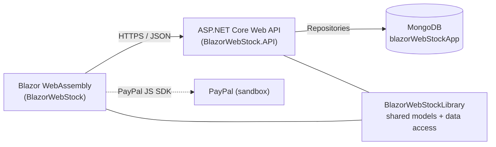

# 🛒 WebStock


A full-stack **web shop** built with **Blazor WebAssembly**, an **ASP.NET Core Web API** and **MongoDB**. Customers can browse products by category, view product details, manage a shopping basket and check out with PayPal (sandbox).


<!-- TODO: add screenshots or a short GIF here, e.g.

-->


---

## ✨ Features

- **Product catalog** with category filtering (client-side, via the REST API)
- **Product detail page** with description, price, stock and *Add to basket*
- **Shopping basket**: view items, remove items, running total
- **Live basket counter** in the navigation bar (event-driven service)
- **PayPal checkout** using the PayPal JS SDK (sandbox)
- **REST API** with Swagger/OpenAPI documentation
- **Repository pattern** with dependency injection on the API side

## 🧱 Architecture



The solution is split into three projects:

| Project | Responsibility |
|---|---|
| `BlazorWebStock` | Blazor WebAssembly front end: pages, components, HTTP services |
| `BlazorWebStock.API` | ASP.NET Core Web API: controllers, repositories, Swagger |
| `BlazorWebStockLibrary` | Shared domain models (`Product`, `Category`, `Basket`, `BasketItem`, `User`) and the MongoDB connection |

### Project structure

```text
BlazorWebStock/
├── BlazorWebStock/              # Blazor WASM client
│   ├── Pages/                   # Index, Products, Detail, Basket, Checkout
│   ├── Services/                # HttpClient-based services (Product, Category, Basket)
│   ├── Shared/                  # Layout and navigation
│   ├── Helpers/                 # Basket total calculations
│   └── wwwroot/                 # index.html, images, PayPal button script
├── BlazorWebStock.API/          # Web API
│   ├── Controllers/             # Product, Category, Basket
│   └── Repositories/            # Data access (MongoDB)
├── BlazorWebStockLibrary/       # Shared models + DbConnection
├── BlazorWebStock.Tests/        # xUnit tests (controllers, helpers)
└── .github/workflows/ci.yml     # Build + test pipeline
```

## 🔌 API endpoints

Swagger UI is available at `https://localhost:7217/swagger` when running in Development.

| Method | Endpoint | Description |
|---|---|---|
| `GET` | `/api/Product` | List all products |
| `GET` | `/api/Product/{id}` | Get a single product |
| `GET` | `/api/Category` | List all categories |
| `GET` | `/api/Basket/{userId}/GetItemsFromBasket` | List the items in a user's basket |
| `GET` | `/api/Basket/{id}` | Get one basket item |
| `POST` | `/api/Basket` | Add an item to the basket |
| `DELETE` | `/api/Basket/{id}` | Remove an item from the basket |

## 🚀 Getting started

### Prerequisites

- [.NET 10 SDK](https://dotnet.microsoft.com/download/dotnet/10.0)
- [MongoDB](https://www.mongodb.com/try/download/community) running locally (or a MongoDB Atlas connection string)
- A trusted HTTPS dev certificate: `dotnet dev-certs https --trust`

### 1. Clone

```bash
git clone https://github.com/ryanzam/webstock.git
cd webstock
```

### 2. Configure the MongoDB connection

The API reads the connection string from `ConnectionStrings:MongoDB` and the database name from `DB` (default `blazorWebStockApp`, set in `appsettings.json`). Keep the connection string out of source control by using user secrets:

```bash
dotnet user-secrets set "ConnectionStrings:MongoDB" "mongodb://localhost:27017" --project BlazorWebStock.API
```

### 3. Seed sample data

The app expects `categories`, `products`, `users` and `baskets` collections. This `mongosh` script creates a small sample catalog. The two `ObjectId`s match the user and basket IDs currently hard-coded in the client (see [Known limitations](#-known-limitations--roadmap)).

```javascript
use blazorWebStockApp

const cameras = { _id: ObjectId(), Name: "Cameras" };
const phones  = { _id: ObjectId(), Name: "Phones" };
const watches = { _id: ObjectId(), Name: "Watches" };
db.categories.insertMany([cameras, phones, watches]);

db.products.insertMany([
  { ProductName: "Nikon DSLR",  Description: "24MP DSLR camera",     Price: NumberDecimal("799.00"), Quantity: 5,  ImgUrl: "img/nikon.jpg",   Category: cameras },
  { ProductName: "Canon Camera", Description: "Mirrorless camera",   Price: NumberDecimal("649.00"), Quantity: 8,  ImgUrl: "img/cannon.jpg",  Category: cameras },
  { ProductName: "iPhone",       Description: "Smartphone",          Price: NumberDecimal("999.00"), Quantity: 10, ImgUrl: "img/iphone.png",  Category: phones  },
  { ProductName: "Samsung",      Description: "Android smartphone",  Price: NumberDecimal("749.00"), Quantity: 12, ImgUrl: "img/samsung.jpg", Category: phones  },
  { ProductName: "Smart Watch",  Description: "Fitness smartwatch",  Price: NumberDecimal("199.00"), Quantity: 20, ImgUrl: "img/watch1.jpg",  Category: watches }
]);

const user = { _id: ObjectId("62cf18af7c3f26e22d05d1a8"), UserName: "demo", Email: "demo@example.com" };
db.users.insertOne(user);
db.baskets.insertOne({ _id: ObjectId("62cfc3752760ffd7be5bde31"), User: user });
```

### 4. Run the API

```bash
dotnet run --project BlazorWebStock.API
```

The API listens on `https://localhost:7217` and opens Swagger automatically.

### 5. Run the Blazor client

In a second terminal:

```bash
dotnet run --project BlazorWebStock/BlazorWebStock.csproj
```

Open **https://localhost:7263**.

> The client calls the API at `https://localhost:7217` (set in `BlazorWebStock/Program.cs`), and the API allows CORS from `https://localhost:7263`. If you change either port, update both places.

## 💳 PayPal checkout

The checkout page uses the PayPal JavaScript SDK in **sandbox mode** (`client-id=sb`) with the basket total, so no real payments are made. To test with your own sandbox account, replace the `client-id` in `BlazorWebStock/wwwroot/index.html` with your PayPal sandbox client ID.

## 🛠 Tech stack

| Layer | Technology |
|---|---|
| Front end | Blazor WebAssembly (.NET 6), Razor components, Bootstrap, Open Iconic |
| Back end | ASP.NET Core 6 Web API, Swashbuckle (Swagger) |
| Database | MongoDB with the official `MongoDB.Driver` (2.16) |
| Payments | PayPal JS SDK (sandbox) |
| Patterns | Repository pattern, dependency injection, service layer, shared class library |
